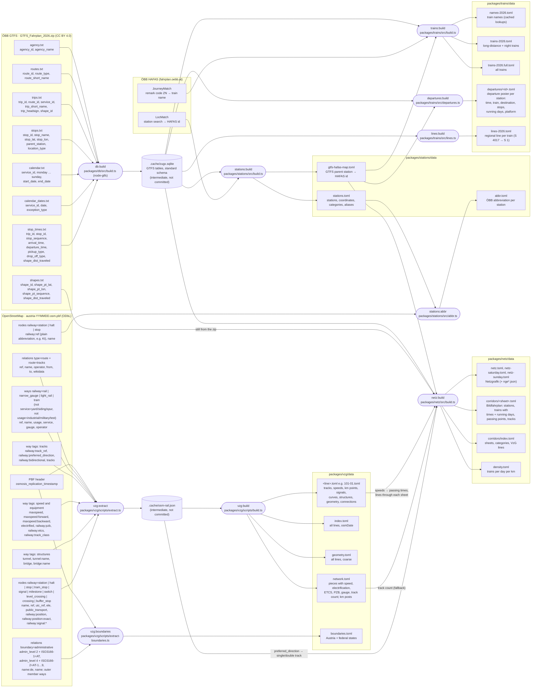

# Data flow: how the committed TOML files are built

Every file under `packages/*/data/` is generated by a build script from three sources: the ÖBB **GTFS** (individual `.txt` files), **OpenStreetMap** (Geofabrik PBF; the keys/tags read), and a few **HAFAS** lookups. The GTFS is first imported into a local **SQLite** (`vp run db:build`, [node-gtfs](https://github.com/BlinkTagInc/node-gtfs), `.cache/zugx.sqlite`, not committed); all GTFS-based scripts read that database, not the zip — only the route shapes still come from the zip. Left: the input files and tags; middle: the database and the scripts (`vp run …`); right: the output files. Licences and fetch dates: [README → Data & licences](../README.md#data--licences).

**Countries** (`packages/gtfs/countries.toml`: feeds, UIC code, OSM extract, national line numbers, licence, SQL fix-ups): every script works on one country, `COUNTRY=<id>` (default `at`, the original paths). Austria writes to `packages/<pkg>/data`, the others to `packages/<pkg>/data/<id>`, each with its own SQLite (`.cache/zugx-<id>.sqlite`) and rail extract (`.cache/osm-rail-<id>.json`); `route:build` merges the committed routing input of all countries (`route:export`, `packages/route/data`), so it needs neither a feed nor a database (CI builds the deployed routing data from it). Rebuilding Slovenia by hand (no automatic updates):

```sh
COUNTRY=si vp run db:build          # IJPP GTFS → .cache/zugx-si.sqlite (+ fix-ups: train names from the route)
COUNTRY=si vp run stations:build    # stations by the UIC code of the HAFAS id (79…)
COUNTRY=si vp run trains:build && COUNTRY=si vp run departures:build
COUNTRY=si vp run vzg:extract && COUNTRY=si vp run vzg:build && COUNTRY=si vp run vzg:boundaries
COUNTRY=si vp run stations:abbr
COUNTRY=si vp run netz:build        # sheets from packages/netz/countries/si.toml (no Netzgrafik)
COUNTRY=si vp run route:export      # routing input → packages/route/data/si/trips-<year>.toml
vp run route:build                  # timetable search over all countries, from the committed input
```

Spain the same way (`COUNTRY=es`; Renfe's train names aren't HAFAS's, so skip the name lookups with `NAMES=0`; the Cercanías lines come from `lines:build`):

```sh
COUNTRY=es vp run db:build && COUNTRY=es vp run stations:build
COUNTRY=es NAMES=0 vp run trains:build && COUNTRY=es vp run departures:build && COUNTRY=es vp run lines:build
COUNTRY=es vp run vzg:extract && COUNTRY=es vp run vzg:build && COUNTRY=es vp run vzg:boundaries
COUNTRY=es vp run stations:abbr && COUNTRY=es vp run netz:build && COUNTRY=es vp run route:export
vp run route:build
```

Germany: DELFI's feed needs a login (opendata-oepnv.de) and covers all modes (4.9 GB unpacked), so download it by hand and extract the rail part first (into `.cache/de-rail/`, the feed path in countries.toml); the OSM extract is `.cache/germany-YYMMDD.osm.pbf`. `db:build` takes about 15 minutes (the fix-ups: stations from the DHIDs, categories, codeshare duplicates) and `stations:build` about an hour the first time (8,300 stations):

```sh
vp run gtfs:rail -- ~/Downloads/<YYYYMMDD>_fahrplaene_gesamtdeutschland_gtfs.zip .cache/de-rail
COUNTRY=de vp run db:build && COUNTRY=de vp run stations:build
COUNTRY=de vp run trains:build && COUNTRY=de vp run departures:build && COUNTRY=de vp run lines:build
COUNTRY=de vp run vzg:extract && COUNTRY=de vp run vzg:build && COUNTRY=de vp run vzg:boundaries
COUNTRY=de vp run stations:abbr && COUNTRY=de vp run netz:build && COUNTRY=de vp run route:export
vp run route:build
```

The diagram shows the Austrian pipeline; the others are the same.



## What comes from where

| Output                               | GTFS                                                                                                                                                           | OSM keys/tags                                                                                                                                                                                                                                                                                                                                       | Other                                                               |
| ------------------------------------ | -------------------------------------------------------------------------------------------------------------------------------------------------------------- | --------------------------------------------------------------------------------------------------------------------------------------------------------------------------------------------------------------------------------------------------------------------------------------------------------------------------------------------------- | ------------------------------------------------------------------- |
| `.cache/zugx.sqlite` (not committed) | all tables except `shapes.txt`, `pathways.txt`, `levels.txt` (imported by node-gtfs into its standard schema)                                                  | –                                                                                                                                                                                                                                                                                                                                                   | –                                                                   |
| `stations/data/stations.toml`        | `stops.txt` (names, coordinates, parent stations), `routes.txt` `route_type` (rail only), `trips.txt` + `stop_times.txt` (departures, categories)              | –                                                                                                                                                                                                                                                                                                                                                   | HAFAS ids from `gtfs-hafas-map.toml`                                |
| `stations/data/abbr.toml`            | –                                                                                                                                                              | nodes `railway=station/halt/stop` with a plain `railway:ref` (1–4 letters) and `name`, matched to `stations.toml` by position (≤ 600 m) and name                                                                                                                                                                                                    | –                                                                   |
| `stations/data/gtfs-hafas-map.toml`  | `stops.txt` (name, coordinates)                                                                                                                                | –                                                                                                                                                                                                                                                                                                                                                   | HAFAS `LocMatch`, scored by name and distance                       |
| `trains/data/trains-2026*.toml`      | `trips.txt` (`trip_short_name` → category + number, `trip_headsign`), `stop_times.txt`, `calendar.txt` + `calendar_dates.txt` (running days)                   | –                                                                                                                                                                                                                                                                                                                                                   | station ids via `gtfs-hafas-map.toml`, names from `names-2026.toml` |
| `trains/data/names-2026.toml`        | (trains from the build)                                                                                                                                        | –                                                                                                                                                                                                                                                                                                                                                   | HAFAS `JourneyMatch`, remark code `ZN`                              |
| `trains/data/lines-2026.toml`        | `trips.txt` (`trip_short_name`) + `routes.txt` (`route_short_name`, e.g. S1, REX1, RX50); most frequent line per train                                         | –                                                                                                                                                                                                                                                                                                                                                   | –                                                                   |
| `trains/data/departures/<id>.toml`   | `stop_times.txt` (departures, `pickup_type`), `trips.txt` (train), `stops.txt` (`platform_code`, parent station), `calendar*.txt` (running days)               | –                                                                                                                                                                                                                                                                                                                                                   | station ids via `gtfs-hafas-map.toml`                               |
| `vzg/data/<line>.toml`, `index.toml` | –                                                                                                                                                              | `route=tracks` relations (`ref`, `name`, `operator`, `from`, `to`, `wikidata`); ways (`ref`, `railway`, `usage`, `service`, `railway:track_ref`, `railway:preferred_direction`, `maxspeed*`, `tunnel*`, `bridge*`, `gauge`); nodes (`railway`, `railway:position*`, `name`, `uic_ref`, `ele`, `railway:signal:*`); PBF header timestamp → `osmDate` | –                                                                   |
| `vzg/data/network.toml`              | –                                                                                                                                                              | as above, plus `electrified`, `railway:etcs`, `railway:pzb`, `operator`; track count = `railway:preferred_direction` forward/backward                                                                                                                                                                                                               | –                                                                   |
| `vzg/data/geometry.toml`             | –                                                                                                                                                              | way geometry of the line paths                                                                                                                                                                                                                                                                                                                      | –                                                                   |
| `vzg/data/boundaries.toml`           | –                                                                                                                                                              | `boundary=administrative`, `admin_level`, `ISO3166-1`, `ISO3166-2`, `name:de`, `name`                                                                                                                                                                                                                                                               | –                                                                   |
| `netz/data/netz*.toml`, `nge*.json`  | `trips.txt`, `stop_times.txt`, `stops.txt`, `calendar*.txt` (one day per day type)                                                                             | –                                                                                                                                                                                                                                                                                                                                                   | HAFAS ids from `gtfs-hafas-map.toml`                                |
| `netz/data/corridors/*.toml`         | whole year: `trips.txt`, `stop_times.txt` (incl. `shape_dist_traveled`), `calendar*.txt` → running-day bitsets; `shapes.txt` → passing points and track counts | `ref` + `railway:preferred_direction` of the sheet's lines (via `.cache/osm-rail.json`)                                                                                                                                                                                                                                                             | VzG speeds (`<line>.toml`) weight the passing times; HAFAS ids      |
| `netz/data/corridors/index.toml`     | reference day: categories, trains per day                                                                                                                      | VzG lines through the sheet's stations                                                                                                                                                                                                                                                                                                              | –                                                                   |
| `netz/data/density.toml`             | trips of the reference day, `shapes.txt` sampled every 500 m                                                                                                   | km posts of the VzG lines (`railway:position`)                                                                                                                                                                                                                                                                                                      | –                                                                   |

GTFS columns in the table are read from the SQLite tables of the same name (`stop_times`, `trips` …), not from the `.txt` files.

Order when rebuilding everything: `db:build` → `stations:build` (→ `stations:abbr`, needs the OSM extract) → `trains:build`, `departures:build`, `lines:build`; `vzg:extract` → `vzg:build` (and `vzg:boundaries`); then `netz:build` (reads the VzG data and the OSM extract).
